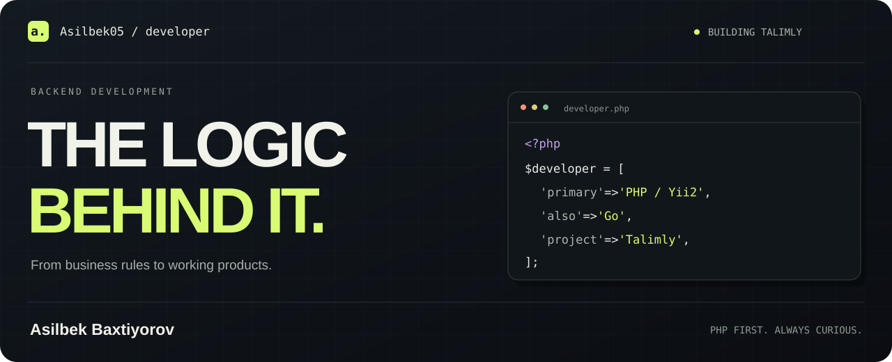
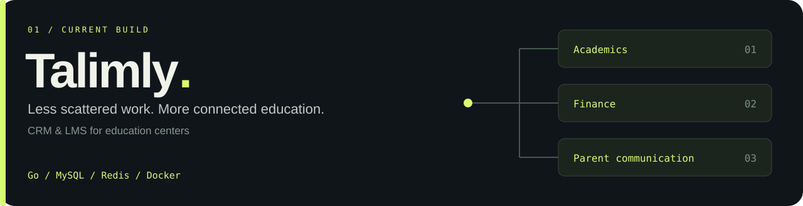

<div align="center">

[](https://t.me/b_asilbek)
[](mailto:baxtiyorov.asilbek2805@gmail.com)
[](https://github.com/Asilbek05)

**Business rules. Data flows. The details behind a working product.**

</div>

<br />

### `~/about`

I'm **Asilbek Baxtiyorov**, a backend developer whose main stack is **PHP and Yii2**.

I enjoy turning business workflows into application logic: how data moves,
who can access it, and what happens when something goes wrong.
I'm also building **Talimly**, working with **Go** on the backend of an education platform.

<br />

### `~/toolbox`


**Data** &nbsp; MySQL · Redis · sqlc · schema migrations  
**APIs & integrations** &nbsp; Gin · REST · OpenAPI · Telegram bots  
**Background work** &nbsp; Asynq · queues · scheduled jobs  
**Delivery** &nbsp; Git · Docker · GitHub Actions

<br />

### `~/building`

[](https://github.com/Asilbek05/talimly)

Education centers handle students, lessons, exams, payments, and parent communication.
**Talimly brings those workflows into one connected CRM & LMS.**

The backend combines tenant isolation, access control, academic workflows,
financial records, Telegram integrations, and background processing.

<details>
<summary><strong>↳ A closer look at the backend</strong></summary>

<br />

- **Structure:** A Go modular monolith with focused business modules.
- **Contracts:** OpenAPI definitions shared across clients and the server.
- **Persistence:** MySQL with sqlc queries and versioned migrations.
- **Async work:** Redis and Asynq for background jobs.
- **Verification:** Go tests and Testcontainers for integration checks.

</details>

**[Explore Talimly ↗](https://github.com/Asilbek05/talimly)**

<br />

### `~/principles`

```text
01  Understand the workflow before choosing the abstraction.
02  Make the code's intent easy to follow.
03  Treat permissions and data integrity as part of the design.
04  Think through failures, retries, and missing data.
05  Keep learning through real projects.
```

---

<div align="center">

**Have a project in mind? Let's talk.**

[Telegram ↗](https://t.me/b_asilbek) &nbsp; · &nbsp; [Email ↗](mailto:baxtiyorov.asilbek2805@gmail.com)

<sub>Asilbek Baxtiyorov / PHP · Yii2 · Go</sub>

</div>
